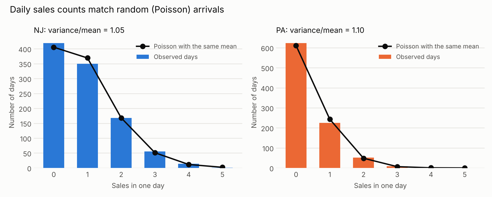
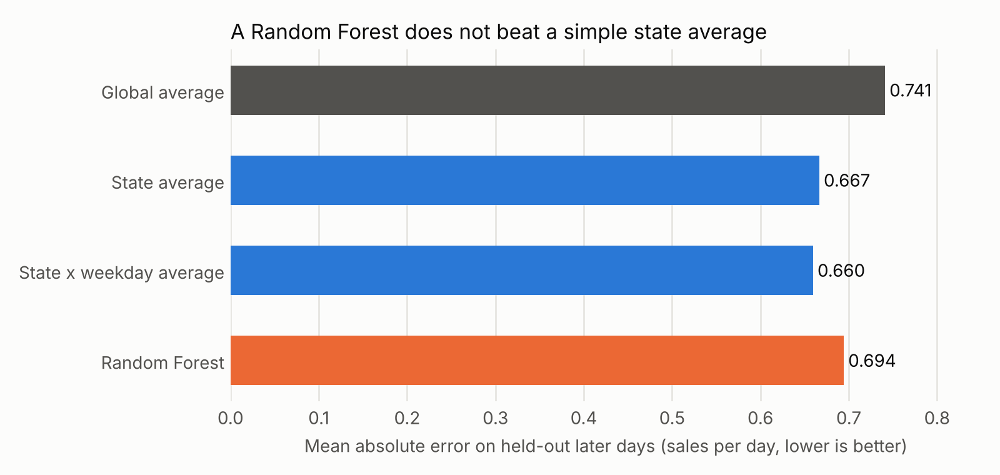

A regional services business wanted a way to forecast demand. I started with about three years of sales records (roughly 1,300 sales across two states, 2022 to 2025) and tested whether calendar features could predict how many sales happen on a given day.

### The first pass

My first models looked promising. One reported an R² of 0.78. But, that number was calculated on the same data the model was trained on. On held-out days the same model scored below zero. Gaps like that between training and test scores are clear signs of overfitting, so I corrected for it on my second pass.

### The cleanup

The first daily table only contained days with at least one sale. That made the average look like 1.5 sales per day. Filling in the days with zero sales (about 42% of days in State A and 69% in State B) brings the real averages down to roughly 0.9 and 0.4 sales per day. I also removed one 37-sale row dated months after the rest of the data ended, which looked like a data error and had single-handedly inflated the variance.

### Filling in the zero sales days:
```python
d = pd.read_csv(sys.argv[1], parse_dates=["date"])
d = d[d.daily_gigs < 20]            # drops one suspect 37-sale row dated after the real data ends

# zero-fill: the original table only had days WITH sales; add the zero days within each state's range
parts = []
for s, g in d.groupby("state"):
    rng = pd.date_range(g.date.min(), g.date.max())
    full = pd.DataFrame({"date": rng, "state": s}).merge(g[["date", "daily_gigs"]], on="date", how="left")
    parts.append(full.fillna({"daily_gigs": 0}))
f = pd.concat(parts).sort_values("date").reset_index(drop=True)
f["month"], f["dow"], f["is_nj"] = f.date.dt.month, f.date.dt.dayofweek, (f.state == "NJ").astype(int)
```

### Test 1: Do daily counts look random?

If sales arrive independently, daily counts should follow a Poisson distribution, where the variance equals the mean. The variance to mean ratio is 1.05 in State A and 1.10 in State B, and the observed counts sit almost exactly on the Poisson curve.

### Comparing observed counts to a Poisson distribution:
```python
# done once for each state (the full loop is in the script at the end)
g = f[f.state == s].daily_gigs; m = g.mean(); ks = np.arange(0, 6)
obs = np.array([(g == k).sum() for k in ks]); exp = stats.poisson.pmf(ks, m) * len(g)

# variance to mean ratio, shown in each chart title:
ax.set_title(f"{s}: variance/mean = {g.var()/m:.2f}", color=INK, fontsize=11, loc="left")
```



### Test 2: Does a model beat a simple average?

I trained on everything before July 2024 and tested on the later days, so the test is a real forecast and not a shuffled split. Error is mean absolute error in sales per day.

### Splitting by date and comparing models:
```python
cut = pd.Timestamp("2024-07-01"); tr, te = f[f.date < cut], f[f.date >= cut]
X = ["month", "dow", "is_nj"]; res = []
def add(name, mu): res.append((name, mean_absolute_error(te.daily_gigs, mu), r2_score(te.daily_gigs, mu)))
add("Global average", np.full(len(te), tr.daily_gigs.mean()))
sm = tr.groupby("state").daily_gigs.mean(); add("State average", te.state.map(sm).values)
sd = tr.groupby(["state", "dow"]).daily_gigs.mean()
add("State x weekday average", [sd.get((s, w), tr.daily_gigs.mean()) for s, w in zip(te.state, te.dow)])
add("Random Forest", RandomForestRegressor(n_estimators=100, random_state=42).fit(tr[X], tr.daily_gigs).predict(te[X]))
r = pd.DataFrame(res, columns=["model", "MAE", "R2"]); print(r.round(3).to_string(index=False))
```



A plain state average (R² 0.12) beats the Random Forest (R² 0.01). Adding the day of the week to the average helped slightly (R² 0.14). Almost all the usable signal is the difference between the two states.

### Which calendar effects are real?

The weekday effect is statistically real (p < 0.001): weekends run lower than weekdays. But it adds very little predictive power. A month effect is not significant (p = 0.09), so I would not plan staffing around a "peak month."

### Testing weekday and month effects:
```python
def dev(df, cols):
    mu = df.groupby(cols).daily_gigs.transform("mean"); y = df.daily_gigs
    return 2 * (np.where(y > 0, y * np.log(np.where(y > 0, y / mu, 1)), 0) - (y - mu)).sum()
base = dev(f, ["state"])
for name, col in [("weekday", "dow"), ("month", "month")]:
    drop = base - dev(f, ["state", col]); df_ = 2 * (f[col].nunique() - 1)
    print(f"{name}: deviance drop {drop:.1f} on {df_} df, p = {stats.chi2.sf(drop, df_):.3f}")
print(f.groupby("dow").daily_gigs.mean().round(2).to_dict())
```

### Takeaways

With counts this close to Poisson, there is little for any model to find, and a large share of day to day variation is chance. The practical forecast is a rate per state, with a slightly lower weekend rate. The more useful work for the business is likely in what sits behind the counts (marketing spend, lead sources), not in a day by day calendar model.

Limits: I assumed days with no record had no sales. If the data feed had gaps, some "zero" days are missing data.

### The full script

The snippets above are the core steps. Here is the complete script, including the code that makes both charts. It reads a small table of dates, states, and daily sales counts.

```python
"""Cremstar daily sales: is demand predictable from calendar features?
Input: daily_clean.csv (columns: date, state, daily_gigs). No customer data needed.
Run: python crem_analysis.py daily_clean.csv
"""
import sys, os, numpy as np, pandas as pd
import matplotlib; matplotlib.use("Agg")
import matplotlib.pyplot as plt
from scipy import stats
from sklearn.ensemble import RandomForestRegressor
from sklearn.metrics import mean_absolute_error, r2_score

INK, MUTED, GRID, SURF = "#0b0b0b", "#52514e", "#e6e5e1", "#fcfcfb"
BLUE, ORANGE = "#2a78d6", "#eb6834"

os.makedirs("out", exist_ok=True)
d = pd.read_csv(sys.argv[1], parse_dates=["date"])
d = d[d.daily_gigs < 20]            # drops one suspect 37-sale row dated after the real data ends

# zero-fill: the original table only had days WITH sales; add the zero days within each state's range
parts = []
for s, g in d.groupby("state"):
    rng = pd.date_range(g.date.min(), g.date.max())
    full = pd.DataFrame({"date": rng, "state": s}).merge(g[["date", "daily_gigs"]], on="date", how="left")
    parts.append(full.fillna({"daily_gigs": 0}))
f = pd.concat(parts).sort_values("date").reset_index(drop=True)
f["month"], f["dow"], f["is_nj"] = f.date.dt.month, f.date.dt.dayofweek, (f.state == "NJ").astype(int)

# 1) Poisson check
fig, axes = plt.subplots(1, 2, figsize=(10, 4), facecolor=SURF, sharey=False)
for ax, (s, col) in zip(axes, [("NJ", BLUE), ("PA", ORANGE)]):
    g = f[f.state == s].daily_gigs; m = g.mean(); ks = np.arange(0, 6)
    obs = np.array([(g == k).sum() for k in ks]); exp = stats.poisson.pmf(ks, m) * len(g)
    ax.set_facecolor(SURF)
    ax.bar(ks, obs, width=0.62, color=col, label="Observed days", zorder=2)
    ax.plot(ks, exp, color=INK, marker="o", ms=7, lw=2, label="Poisson with the same mean", zorder=3)
    ax.set_title(f"{s}: variance/mean = {g.var()/m:.2f}", color=INK, fontsize=11, loc="left")
    ax.set_xlabel("Sales in one day", color=MUTED); ax.set_ylabel("Number of days", color=MUTED)
    ax.grid(axis="y", color=GRID, lw=1, zorder=0); [sp.set_visible(False) for sp in ax.spines.values()]
    ax.tick_params(colors=MUTED, length=0); ax.legend(frameon=False, labelcolor=MUTED, fontsize=9)
fig.suptitle("Daily sales counts match random (Poisson) arrivals", color=INK, fontsize=13, x=0.02, ha="left")
fig.tight_layout(); fig.savefig("out/01_poisson_check.png", dpi=200, facecolor=SURF); plt.close(fig)

# 2) Time-ordered holdout: train before cut, test after
cut = pd.Timestamp("2024-07-01"); tr, te = f[f.date < cut], f[f.date >= cut]
X = ["month", "dow", "is_nj"]; res = []
def add(name, mu): res.append((name, mean_absolute_error(te.daily_gigs, mu), r2_score(te.daily_gigs, mu)))
add("Global average", np.full(len(te), tr.daily_gigs.mean()))
sm = tr.groupby("state").daily_gigs.mean(); add("State average", te.state.map(sm).values)
sd = tr.groupby(["state", "dow"]).daily_gigs.mean()
add("State x weekday average", [sd.get((s, w), tr.daily_gigs.mean()) for s, w in zip(te.state, te.dow)])
add("Random Forest", RandomForestRegressor(n_estimators=100, random_state=42).fit(tr[X], tr.daily_gigs).predict(te[X]))
r = pd.DataFrame(res, columns=["model", "MAE", "R2"]); print(r.round(3).to_string(index=False))
fig, ax = plt.subplots(figsize=(8, 3.8), facecolor=SURF); ax.set_facecolor(SURF)
cols = [MUTED, BLUE, BLUE, ORANGE]
b = ax.barh(r.model[::-1], r.MAE[::-1], color=cols[::-1], height=0.55, zorder=2)
for rect, v in zip(b, r.MAE[::-1]): ax.text(v + 0.005, rect.get_y() + rect.get_height()/2, f"{v:.3f}", va="center", color=INK, fontsize=10)
ax.set_xlim(0, 0.85); ax.set_xlabel("Mean absolute error on held-out later days (sales per day, lower is better)", color=MUTED)
ax.grid(axis="x", color=GRID, lw=1, zorder=0); [sp.set_visible(False) for sp in ax.spines.values()]
ax.tick_params(colors=MUTED, length=0); ax.set_title("A Random Forest does not beat a simple state average", color=INK, fontsize=12, loc="left")
fig.tight_layout(); fig.savefig("out/02_model_vs_baseline.png", dpi=200, facecolor=SURF); plt.close(fig)

# 3) Which calendar effects are real?
def dev(df, cols):
    mu = df.groupby(cols).daily_gigs.transform("mean"); y = df.daily_gigs
    return 2 * (np.where(y > 0, y * np.log(np.where(y > 0, y / mu, 1)), 0) - (y - mu)).sum()
base = dev(f, ["state"])
for name, col in [("weekday", "dow"), ("month", "month")]:
    drop = base - dev(f, ["state", col]); df_ = 2 * (f[col].nunique() - 1)
    print(f"{name}: deviance drop {drop:.1f} on {df_} df, p = {stats.chi2.sf(drop, df_):.3f}")
print(f.groupby("dow").daily_gigs.mean().round(2).to_dict())
```

Code: Python, pandas, scikit-learn, SciPy, Matplotlib.
